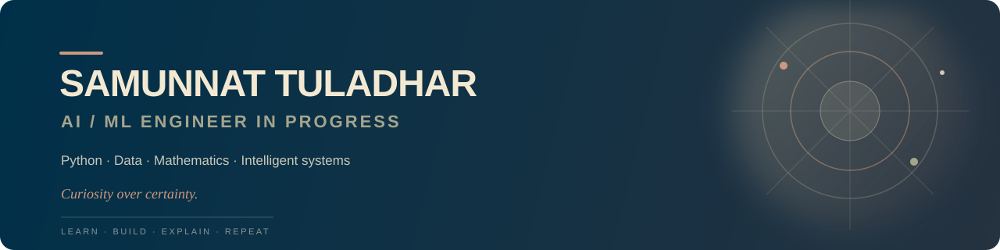

# Hi, I'm Samunnat Tuladhar

> Aspiring AI/ML Engineer building strong foundations in Python, data, and intelligent systems — one deliberate experiment at a time.

  

  

## About Me

I am currently learning artificial intelligence and machine learning, with a focus on the fundamentals that make intelligent systems meaningful and reliable.

My learning path centers on Python, algorithms, data structures, mathematics, and practical experimentation. I learn best by building small, focused projects that turn concepts into something I can test, explain, and improve.

> Curiosity over certainty.

## Current Focus

- Strengthening my Python foundations
- Studying algorithms and data structures
- Building a stronger base in mathematics for machine learning
- Exploring data workflows and intelligent systems
- Creating small projects that make learning practical
- Growing a portfolio honestly, one project at a time

## Technologies I'm Exploring

### Languages and Data

### Machine Learning and APIs

### Databases, Cloud, and Tools

## Featured Projects

<table>
  <tr>
    <td width="50%" valign="top">
      <h3><a href="https://github.com/samunnatdev/samunnat-portfolio">Samunnat Portfolio</a></h3>
      
A responsive personal profile and portfolio site documenting my AI/ML learning path, current work, experience, and contact links.

      

        
        
        
        
      

      <a href="https://github.com/samunnatdev/samunnat-portfolio">View repository →</a>
    </td>
    <td width="50%" valign="top">
      <h3><a href="https://github.com/samunnatdev/samunnatdev">GitHub Profile</a></h3>
      
A living profile README with a custom banner, themed tech stack, contribution streak, visitor counter, and links to my work.

      

        
        
        
      

      <a href="https://github.com/samunnatdev/samunnatdev">View repository →</a>
    </td>
  </tr>
</table>

## Learning Through Building

I use small, focused exercises and projects to reinforce what I study. The goal is not just to collect tools, but to understand the ideas behind them and build skills that compound over time.

Projects are being added as they develop. You can follow that progress on my [GitHub profile](https://github.com/samunnatdev).

<!-- PROFILE_STATS:START -->

  
  
  
   
  Portfolio snapshot refreshed 2026-11-09 · updated weekly by GitHub Actions

<!-- PROFILE_STATS:END -->

## Contribution Streak

  

  

## Now Playing

  

## Guestbook

  <strong>Have a question, idea, or kind note?</strong> 
  Leave a message in the guestbook — I would love to hear from you.

  
  

Messages are public GitHub issues. Please keep them kind, constructive, and on topic.

## Contact & Socials

  
  
  
  

If you are also learning AI, machine learning, or the foundations behind them, feel free to connect.
